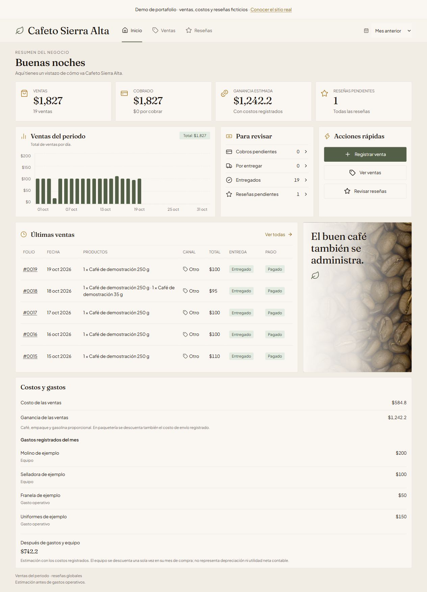
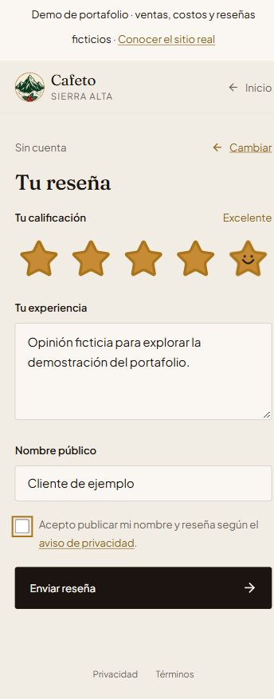
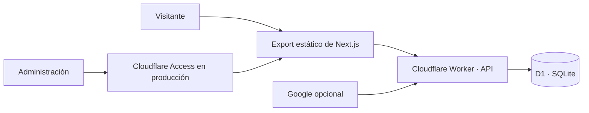

# Cafeto Sierra Alta · Portafolio


[](https://github.com/Crisls24/cafeto-sierra-alta-portfolio/actions/workflows/ci.yml)

**Un catálogo B2B conectado con la operación de un negocio real de café.**
Sitio comercial, administración de ventas, costos históricos y reseñas por
invitación, construidos con Next.js, TypeScript y Cloudflare Workers + D1.

**[Sitio real en producción](https://cafeto.iscx.site)** ·
**[Cómo probar la demo](#probar-la-demo)** ·
**[Diseño](DESIGN.md)** · **[Seguridad](SECURITY.md)**

> Esta es la versión de portafolio de un proyecto en producción. Los datos de
> ventas, costos, gastos y reseñas son ficticios. La identidad fiscal, el
> domicilio, las credenciales y el historial operativo del negocio quedan fuera
> de este repositorio. Las capturas muestran exclusivamente la demostración.

## El problema

El negocio necesita presentar su catálogo a empresas, oficinas y escuelas,
facilitar cotizaciones y dar seguimiento a ventas, pagos y entregas. También
necesita conocer el margen de sus ventas y recopilar opiniones vinculadas con
compras reales, sin obligar al cliente a crear una cuenta.

El proyecto reúne esas funciones en una interfaz adaptable al teléfono y una
API que controla los datos y las acciones administrativas.

## Qué se puede explorar

- **Sitio comercial:** catálogo filtrable, presentaciones, molienda, tueste,
  páginas de origen y compra por mayoreo, metadatos y datos estructurados.
- **Dashboard:** ventas del periodo, cobros, entregas, gráfica diaria,
  ganancia estimada y desglose mensual de gastos y equipo.
- **Ventas:** registro con varias líneas, precios y costos históricos,
  búsqueda, filtros, pagos, entrega y cancelación.
- **Reseñas:** invitación de un solo uso, calificación con estrellas animadas,
  comentario y moderación antes de publicar.
- **Accesibilidad:** navegación con teclado, foco visible, etiquetas accesibles,
  controles táctiles y respeto a `prefers-reduced-motion`.

En la demo se desactivan el contacto comercial y los proveedores externos.
El código de identificación opcional con Google y validación de Cloudflare
Access se conserva para mostrar la integración del proyecto real.

## Capturas de la demostración

### Dashboard



### Experiencia de reseña en celular



## Arquitectura



Next.js genera archivos estáticos; el Worker sirve esos archivos y atiende la
API. La base no se expone al navegador. En producción, Cloudflare Access protege
el panel y el Worker vuelve a comprobar el JWT en las rutas administrativas.

## Decisiones técnicas

- **TypeScript y Zod:** contratos entre interfaz y API, validación de entradas
  y estados de error explícitos.
- **D1 y SQL parametrizado:** persistencia relacional con migraciones y
  relaciones entre ventas, artículos, invitaciones y reseñas.
- **Precios y costos históricos:** cambiar el catálogo no recalcula una venta
  anterior. Los costos incompletos se muestran como pendientes.
- **Tokens de invitación hasheados:** una venta admite una reseña y el consumo
  de la invitación se controla de forma atómica.
- **Moderación:** una opinión entra como pendiente; publicar, ocultar y volver
  a revisar son acciones del equipo administrador.
- **Privacidad:** los datos operativos permanecen en el sistema privado;
  este repositorio utiliza ejemplos reproducibles.
- **Sistema visual compartido:** los tokens de diseño viven en `@theme` y se
  reutilizan en catálogo, formularios y administración.

## Probar la demo

Requisitos: **Node.js 22**, npm y un entorno que permita abrir un servidor local.
La compilación descarga las fuentes de Google Fonts. No requiere cuentas de
Google, Cloudflare ni claves de API para explorar la demostración local.

```bash
git clone https://github.com/Crisls24/cafeto-sierra-alta-portfolio.git
cd cafeto-sierra-alta-portfolio
npm ci
npm run demo
```

El comando prepara D1 local, carga datos ficticios, compila el sitio y abre el
Worker en el puerto **8788**. La terminal imprime también el enlace de la
invitación de reseña de demostración.

- Sitio: `http://localhost:8788/`
- Dashboard: `http://localhost:8788/admin/`
- Ventas: `http://localhost:8788/admin/ventas/`
- Reseñas: `http://localhost:8788/admin/resenas/`

La carga se ubica en el **mes anterior** a la fecha de ejecución y el dashboard
selecciona ese periodo al abrir. Incluye ventas, gastos, tres opiniones en
distintos estados y una invitación para recorrer el formulario.
La preparación utiliza exclusivamente `--local` y puede repetirse sin duplicar
los registros del mismo periodo. Si consumes la invitación, puedes generar otra
desde el detalle de una venta elegible.

Para trabajar por pasos:

```bash
npm run demo:prepare
npm run build -- --webpack
npm run demo:start
```

El bypass de Access generado en `.dev.vars` es exclusivo de esta demostración
local. Una instancia publicada requiere su propia base, políticas y secretos;
el identificador D1 del repositorio es deliberadamente ficticio.

## Pruebas y calidad

```bash
npm run lint
npm run typecheck
npm run test
npm run test:ui
npm run test:importacion
npm run test:costos
npm run test:export
```

Las pruebas del Worker usan D1 local. Cubren ventas, pagos, estados,
invitaciones, consumo atómico, moderación e identidad de Google con claves de
prueba. Las pruebas de importación y costos usan datos ficticios y bases
temporales. GitHub Actions verifica una instalación limpia y la compilación
sin secretos ni acceso al despliegue real.

## Estructura

```text
src/app/            Páginas públicas, legales y administración
src/componentes/    Componentes del sitio y paneles
src/data/           Catálogo, textos y configuración de demostración
src/lib/            Clientes de API, validación y formato
worker/             API, autenticación y acceso a D1
migrations/         Esquema versionado
examples/           Datos ficticios para pruebas y demo
scripts/            Preparación de demo, cargas y exportación
screenshots/        Capturas con datos ficticios
```

## Alcance

La ganancia es una estimación con los costos registrados, no un cálculo fiscal.
El equipo se distingue del gasto operativo. Las reseñas propias no se publican
automáticamente en Google Maps. Places API permanece sin configurar y no forma
parte de los requisitos de la demo.

El nombre y la identidad visual de Cafeto Sierra Alta se muestran para
contextualizar el proyecto real. Esta copia es una demostración técnica y no
procesa pedidos ni representa información comercial vigente.
